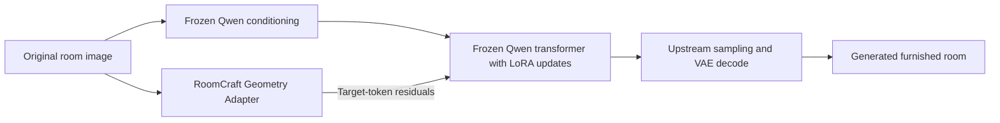
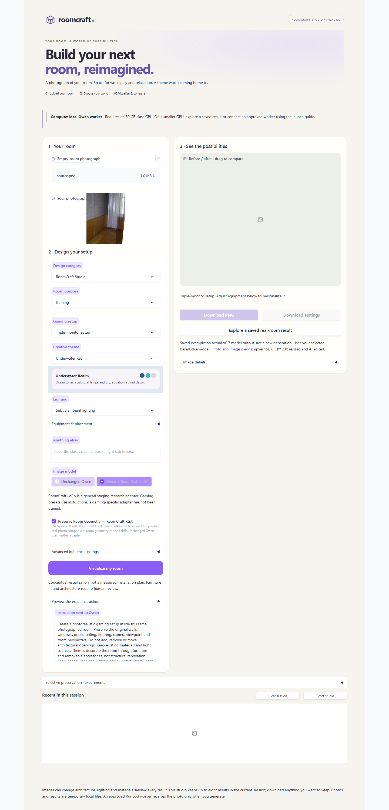
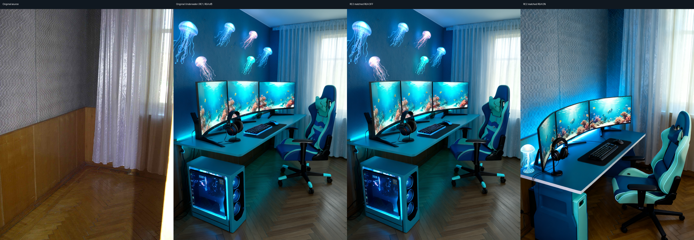
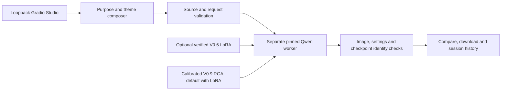

# RoomCraft Studio

**RoomCraft AI v1.1.0 · Public source-code and research release.** [Release provenance and exclusions](PUBLICATION.md).

**Visualize a room for work, play and relaxation.**

RoomCraft is a local Gradio application that turns a room photograph and your design choices into a conceptual interior visualization. Choose Gaming, Work, Relaxation or Mixed-purpose independently of six decorative themes. Compare original and generated images, download native PNGs and exact settings, and revisit up to eight session results.

## Mathematics & Neural Network Engineering

RoomCraft's neural-network work adapts **frozen Qwen-Image-Edit-2511 components** rather than training a new foundation model. The project implements paired-data/cache contracts, gradient-reachable attention adapters, a target-only flow objective, training/resume checks, and a compact geometry-conditioning path. Standard LoRA, flow matching, backpropagation and AdamW are credited to their original researchers and libraries.

**Low-rank linear algebra.** For a frozen projection $W_0$, RoomCraft learns small matrices $A$ and $B$:

$$
W_{\mathrm{eff}}=W_0+\frac{\alpha}{r}BA,\qquad
A\in\mathbb{R}^{r\times d_{\mathrm{in}}},\quad
B\in\mathbb{R}^{d_{\mathrm{out}}\times r}.
$$

This adds $r(d_{\mathrm{in}}+d_{\mathrm{out}})$ trainable parameters instead of updating every dense weight. At rank 8, 479 selected Qwen attention projections contain **23,543,808 trained LoRA parameters**. The last block's unused text-output projection is excluded because it has no gradient path to image loss. The VAE/VLM are frozen and their conditioning is cached.

**Conditional flow matching.** A furnished target latent $z_0$ is mixed with Gaussian noise, while the original room and instruction remain clean conditioning:

$$
z_\sigma=(1-\sigma)z_0+\sigma\epsilon,\qquad
u=\frac{\partial z_\sigma}{\partial\sigma}=\epsilon-z_0,\qquad
\mathcal{L}=\operatorname{mean}_{\text{target tokens, channels}}(p-u)^2.
$$

The implementation samples $\sigma$ uniformly and predicts velocity; reference output tokens receive no direct reconstruction loss. **Backpropagation** sends the loss signal through layer Jacobians using the chain rule:

$$
\nabla_\theta\mathcal{L}=J_{h,\theta}^{\top}\nabla_h\mathcal{L}.
$$

PyTorch's **AdamW** accumulates first/second gradient moments, applies bias correction and updates only the trainable parameters with decoupled weight decay. RoomCraft averages four microbatch gradients per pilot update, checks finite gradients, clips their global norm to 1 and saves optimizer state for resumption.

**Original RoomCraft Geometry Adapter.** RGA encodes source Canny edges and XY coordinates with four Conv/GroupNorm/SiLU stages and a zero-initialized projection. Its **728,512 trained parameters** produce target-aligned residuals injected through the frozen Qwen transformer. During RGA training, the existing LoRA is frozen too; transformer input derivatives remain active so gradients can reach RGA. The calibrated checkpoint's gain is $10^8$, explicitly recorded rather than hidden.



**Evidence:** two-update smoke/resume checks, a fresh 100-update LoRA pilot, two 100-update RGA pilots, tensor/gradient tests and frozen-state checks. Exact RGA replay is verified in its tested setup; bitwise full-model LoRA GPU replay is not claimed. Successful training is distinct from better images: earlier geometry ablations were mixed, and the positive Underwater result is **one real photo and one seed**, not a universal guarantee.

[Read the equations, dimensions, parameter-count derivations, optimizer/resume details, source/test map and attribution](docs/MATHEMATICS_AND_MODEL_ENGINEERING.md). See also [LoRA training evidence](docs/MODEL_CARD_V06_PILOT.md), [controlled ablation findings](docs/RESEARCH_RESULTS.md) and [the approved Underwater comparison](docs/RGA_VALIDATION.md).




## Start the application

Install Python 3.12 and [uv](https://docs.astral.sh/uv/), extract the candidate ZIP, and run from its root:

```bash
uv sync --project environments/app --frozen
uv run --project environments/app python scripts/launch_app.py
```

Open **http://127.0.0.1:7860**. **Explore a saved real-room result** exercises comparison, downloads and history without a GPU; those pixels are labeled historical. The UI never provisions paid resources. The application is a loopback tool, not an authenticated public service.

For fresh inference, install the separate pinned worker on suitable hardware:

```bash
uv sync --project environments/qwen --frozen
uv run --project environments/qwen roomcraft edit-preflight
uv run --project environments/app python scripts/launch_app.py
```

The unquantized worker needs an 80 GB class NVIDIA GPU, at least 64 GiB available host RAM (128 GB host recommended), and about 54 GiB of model/cache storage. Qwen downloads the pinned foundation through Hugging Face when needed. [Installation and checkpoint paths](docs/APP_GUIDE.md), [explicitly approved Runpod workflow](docs/RUNPOD.md).

**Adapter availability:** V0.6 LoRA and calibrated V0.9 RGA weights are private and excluded from this source release. There is no public adapter download yet. Unchanged Qwen and saved examples remain available; fresh RoomCraft LoRA/RGA inference requires the verified separately supplied safetensors and configs. Missing or mismatched checkpoints fail clearly without substituting another model. [Distribution and hashes](docs/ADAPTER_DISTRIBUTION.md).

## Preserve Room Geometry — RoomCraft RGA

Select **Qwen + RoomCraft LoRA** to enable the calibrated V0.9 RGA by default. Its visible checkbox switches OFF for the LoRA-only baseline. The initial **Unchanged Qwen** selection and reset behavior are preserved; Qwen alone uses neither adapter. RGA uses the source geometry during inference; it is separate from optional manual-mask compositing.

The matched Underwater Realm example preserved the distinctive wallpaper and room framing better and avoided an invented ceiling, while keeping the ocean theme. Residual diagnostics verify that the trained checkpoint was active.



**This is one positive real-photo example, not proof of consistent improvement across rooms.** Small geometric shifts, material/color changes, occluded boundaries and monitor-count mistakes remain possible. Furniture quality is not consistently better, and a photograph cannot establish physical clearance or measured fit. Earlier multi-room research was mixed. [Matched settings, limitations and activation evidence](docs/RGA_VALIDATION.md) · [Full-resolution gallery](docs/assets/rga-underwater/index.html).

All demonstration images derive from **upyernoz**, [Our Hotel Suite-1](https://commons.wikimedia.org/wiki/File:Our_Hotel_Suite-1_(4983234010).jpg), [CC BY 2.0](https://creativecommons.org/licenses/by/2.0/); resized and AI edited, without endorsement. [Image notices](docs/assets/example/LICENSE.md), [RGA demo attribution](docs/assets/rga-underwater/LICENSE.md).

## Design controls

- Four purposes: Gaming, Work, Relaxation and Mixed-purpose, with purpose-specific equipment and seating.
- Six themes: Pirate's Cove, Cat Kingdom, Underwater Realm, Cyberpunk Neon, Enchanted Forest and Minimalist Luxury; optional custom theme.
- Six gaming setups; desk, PC placement, monitor arrangement, chair, peripherals, shelving and lighting controls.
- Exact-prompt preview, seed/resolution/steps/guidance settings, before/after slider, PNG/settings downloads and session history.
- Separate unchanged-Qwen and trained-LoRA choices, explicit RGA OFF baseline, and optional local mask-derived preservation previews.

Themes and purpose controls compose instructions; a gaming-specific adapter has not been trained. All modes/themes have browser and transport coverage. Fresh GPU image quality has not been evaluated for every mode/theme combination. Results remain conceptual visualizations.

## Architecture



RoomCraft owns the UI/composer, paired-data checks, project LoRA training implementation, geometry encoder/residual integration, scene generators and evaluation tools. Qwen/Diffusers provide foundation components and sampling. LoRA and conditional residual adapters are established methods; no invention of those methods is claimed. [Architecture](docs/ARCHITECTURE.md), [model card](docs/MODEL_CARD.md), [training mathematics](docs/QWEN_TRAINING_V04.md), [RGA architecture](docs/GEOMETRY_ADAPTER.md).

## Verification and release boundaries

```bash
uv sync --frozen
uv run pytest -q
uv run ruff check .
uv run ruff format --check .
uv run mypy
uv run --project environments/qwen python -m pytest -q
```

Browser checks and the no-GPU mode/theme/RGA journey are documented in [CONTRIBUTING.md](CONTRIBUTING.md). [Release report](ROOMCRAFT_V11_FINAL_RELEASE_REPORT.md).

The current UI audit reports zero known advisories, with a documented Gradio/Pillow dependency-bound override. The pinned Qwen and SDXL research environments retain known advisories; they are not security-cleared public services. [Exact findings and handling](docs/SECURITY_AUDIT.md), [privacy guidance](SECURITY.md). Weights, datasets, private account receipts, credentials, caches and third-party asset binaries are excluded from the reviewed source ZIP. Publish the audited candidate rather than the raw research workspace.

Original code is **MIT**. Qwen declares **Apache-2.0**; other model/data/image/dependency terms remain separate. **Powered by Poly Haven.** [Attribution and license boundaries](NOTICE.md).
