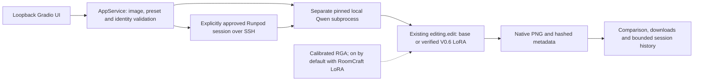
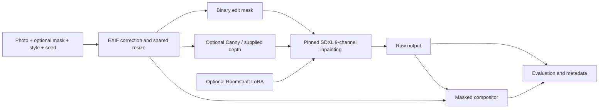

# Architecture

## V1.0 local application

The UI environment is intentionally independent of the pinned model environments. `app_service.py` imports no Torch/Diffusers code. `app_worker.py` executes the existing backend; requests and outputs are exchanged as JSON/PNG. Prompt strings never enter shell commands. The Runpod helper reuses exact-resource checks and shutdown functions while requiring a fresh bounded approval for its own startup. It does not create volumes. The local UI cannot provision paid resources.

Only the original source preview is resized for matched comparison; generated dimensions come from actual inference and are verified. Output hashes, source identity, settings and adapter identity must match before an image enters session history. Missing weights, worker failures and mismatches are errors, not base-model substitutions. [Application guide](APP_GUIDE.md), [security audit](SECURITY_AUDIT.md).

## Preserved SDXL research path

`preprocess.py` owns transforms and mask polarity: white edits, black protects. Long-side resizing rounds each dimension to a multiple of 64 without cropping. This introduces small aspect-ratio rounding, which is recorded through working dimensions. There is no hidden automatic depth estimation or semantic segmentation. Supplied depth must align with the original oriented photograph; near is bright and far dark. Depth choice and calibration can affect ControlNet substantially.

`inference.py` loads an immutable base snapshot, optionally a matching SDXL ControlNet, and optionally a project-format LoRA. CPU offload and VAE tiling are available. A hard binary compositor preserves source pixels outside the mask **at working resolution**, while potentially causing seams and preventing shadows from crossing the mask. Raw outputs remain available for honest model evaluation.

`data.py` validates provenance assertions, checksums, path containment, splits and dimensions. It cannot verify that a rights assertion is truthful or that two photographs have identical camera geometry. Scene IDs must group all related views, crops and derivatives. Near-duplicate detection and pair alignment review remain human ingestion tasks.

`lora.py`, `objective.py`, `checkpoint.py` and `training.py` provide the project-owned training architecture. The pretrained VAE and text encoders stay frozen. Attention projection adapters train on target-image diffusion noise prediction with masked source conditioning. Training currently uses mask-only conditioning; frozen ControlNet is an inference ablation. There is no claim that the adapters learn structural control specifically.

Single-device microbatch size is one, with configurable accumulation. Sampling is with replacement using a deterministic step-derived seed. Images can have different aspect ratios because examples are processed individually. No DDP, quantized training, automatic hyperparameter search, segmentation model, web service or cloud control plane is needed for V0.1.

`evaluation.py` compares matched runs and writes geometry proxies, contact sheets and blinded human score forms. It refuses differences in base, inputs, prompts or generation settings. Compare mask/depth/edge ablations as separate experiments, not as adapter-only causal comparisons.
# V0.4 Qwen training path

`qwen_data` validates explicit rights-reviewed pairs and property-level splits. `qwen_cache` uses the pinned Qwen VAE/VLM to store immutable conditioning tensors. `qwen_objective` combines noisy target tokens with clean source tokens, uses zero reference time and computes target-only flow loss. `qwen_training` owns LoRA selection, accumulated optimizer updates, gradient diagnostics, validation and checkpoints. `qwen_evaluation` checks matched baseline/adapter metadata and produces blind review artifacts. These additions do not route through SDXL's DDPM objective. See [Qwen training](QWEN_TRAINING_V04.md).

## Gaming Room Studio V1.1

`GamingConfig` and `compose_gaming` compile the original six-theme registry, equipment, lighting and room constraints into the existing editing instruction. The UI preview and Generate path use this same composer. `AppService` verifies the unchanged worker result and records the complete recipe/theme snapshot in downloadable metadata. No neural architecture or trained weight changed. [Application details](GAMING_STUDIO.md).

## Final RoomCraft Studio polish

Independent room-purpose/theme controls and optional local selective-preservation derivatives are documented in [FINAL_POLISH.md](FINAL_POLISH.md). Original model checkpoints and research methods remain unchanged. The matched Underwater comparison now demonstrates one positive example with active calibrated V0.9 RGA: improved wallpaper and framing, with remaining shifts. This does not establish consistent improvement. See [verified RGA comparison](RGA_VALIDATION.md).

## V1.1 RC3 geometry integration

**Preserve Room Geometry — RoomCraft RGA** is visible beside model selection and is automatically enabled when RoomCraft LoRA is selected. Switch it off for LoRA-only inference. Unchanged Qwen remains the initial/reset model choice, with RGA disabled. Selecting LoRA again restores its default RGA-on state. The pinned base, LoRA and calibrated RGA checkpoints and inference mathematics are unchanged. Downloaded metadata records actual geometry conditioning; saved examples retain their historical settings rather than inheriting the current checkbox.

The matched Underwater comparison shows better wallpaper, camera/room framing and visible preservation with active RGA. This is one positive example, not proof of reliable preservation across rooms. Monitor count, small geometric shifts, materials, occlusion and furniture clearance remain limitations. [Full evidence and gallery](RGA_VALIDATION.md). No new GPU generation occurred for this release audit.
