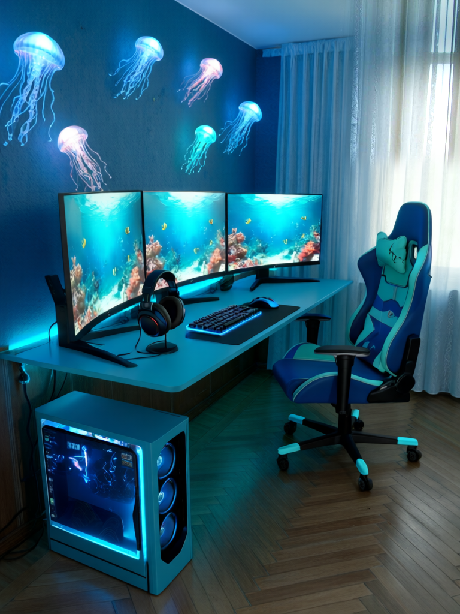

# RoomCraft Studio — final polish and preservation

Room purpose and decorative theme are independent. Gaming retains detailed equipment controls. Work offers standard/sit-stand/laptop desks and laptop/single/dual displays. Relaxation offers armchair/sofa/chaise and optional reading lamp/books. Mixed-purpose selects Work + relaxation, Gaming + work, or Gaming + relaxation, requests shared furniture and conservative placement. Theme and lighting remain independent; legacy room presets remain under Design category. Every displayed purpose-specific choice participates in exact-prompt preview and generation metadata.

The original LoRA, foundation model and trained geometry adapter are unchanged. See [architecture](ARCHITECTURE.md), [Qwen training mathematics](QWEN_TRAINING_V04.md), [RGA architecture](GEOMETRY_ADAPTER.md), [research findings](RESEARCH_RESULTS.md), [dataset provenance](DATASET_GENERATION.md), [model card](MODEL_CARD.md) and [security review](SECURITY_AUDIT.md).

## Selective preservation

This optional, experimental local postprocessing tool uses the same source/generated compositing concept as the SDXL preprocessing path, with a soft inward boundary instead of its binary mask. Upload a PNG mask matching the original EXIF-oriented photo dimensions: **white restores architecture; black retains the generated image**. An optional foreground PNG marks furniture white to exclude it from restoration. Validate alignment manually; this is not automatic semantic segmentation. Foreground exclusions are dilated two pixels; protection is eroded before blur, then multiplied by the original allowed region so source restoration cannot bleed into furniture. UI derivatives match broad generated illumination with low-frequency channel differences. Original pixels are not guaranteed under lighting matching.

The displayed result is the target. Apply creates a separately labeled derivative with raw-output hash, mask hashes, effective-alpha hash and feather setting. Original output remains in history. PNG/settings downloads, history selection and comparison work for derivatives. No model call or GPU allocation occurs. Alpha and masks are retained in the temporary derivative job; download settings before clearing the session.



The practical Underwater experiment tested two raw-copy masks and a corrected lighting-matched window patch. Broad background copying visibly erased decorations and produced color/geometry discontinuities: rejected. The initial window rectangle also had a hard transition: rejected. Inward erosion/feathering plus lighting matching reduced that boundary without erasing desk, monitors or chair. The final patch is limited to unoccluded upper curtain/window pixels; the blue wall, added ceiling and changed camera framing remain. This is a limited compositing preview, not whole-room preservation, a fit guarantee or proof of RGA improvement. Different curtain folds and lighting can still be perceptible. Avoid masks across furniture or mismatched wall/floor edges. Default generation remains raw.

Photo: upyernoz, [Our Hotel Suite-1](https://commons.wikimedia.org/wiki/File:Our_Hotel_Suite-1_(4983234010).jpg), [CC BY 2.0](https://creativecommons.org/licenses/by/2.0/). Resized and AI edited, with manual masks/compositing; no endorsement implied.

## Historical RC2 preparation and completed RGA comparison

The saved challenging Underwater baseline uses source 768 × 1024, seed 42, 40 steps, true CFG 4, LoRA V0.6 and RGA off. `scripts/verify_rga_pair.py` checks the exact saved prompt before generation, then checks source hash, foundation revision, LoRA SHA, dimensions and every sampling setting against that baseline. It runs through Gradio on an already approved worker and has no provisioning capability. Its output directory must be new. The calibrated checkpoint remains unchanged. Its completed single-example result and current integration are documented in [RGA validation](RGA_VALIDATION.md).

```bash
uv run --project environments/app python scripts/verify_rga_pair.py --url http://127.0.0.1:7863 --baseline outputs/v11-themes-live/underwater_realm.json --image docs/assets/example/source.png --output outputs/final-polish/rga-pair
```

This was the original RC2 handoff. The comparison subsequently completed under separate approval; see [verified result](RGA_VALIDATION.md). Fresh full-model outputs require separate owner approval and the bounded workflow in [RUNPOD.md](RUNPOD.md). Do not reuse earlier test approval. Visually inspect window frames, panel boundaries, ceiling, floor, viewpoint, furniture support/placement and lighting. Mark occluded landmarks as unobservable. Pixel/hash differences do not establish architectural improvement. Historical RGA evidence does not substitute for this exact Underwater pair.

## Release scope

RC2 is an unpublished source candidate for owner review. The original V1.1 RC1 archive is preserved. No new paid resource, retraining, Brasik/Rulbi modification or publication is part of this polish execution. Model weights, full datasets, caches, credentials and private receipts remain excluded. Purpose controls have CPU/transport/browser coverage; new Work/Relaxation/Mixed-purpose image quality is untested on a GPU. See [final polish report](../ROOMCRAFT_FINAL_POLISH_REPORT.md).
