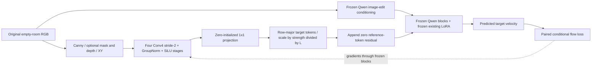

# RoomCraft Geometry Adapter (RGA v1)

**Current release:** Calibrated V0.9 RGA is trained and defaults on with RoomCraft LoRA in V1.1 RC3. [The matched Underwater comparison](RGA_VALIDATION.md) is one positive real-photo example; previous broader studies remain mixed. The architecture/mathematics below are the original V0.8 record, with V0.9 checkpoint residual gain 1e8 supplied by its verified config. No weights or training changed for this integration.

## Motivation and ownership

V0.7's actual comparisons show enlarged/moved windows, changed projecting walls, a relocated doorway, lost ceiling features and new outlets. The existing LoRA reduces several failures, but native 1024 also helps unchanged Qwen and neither guarantees preservation. See window-room seed 17 (`../outputs/v07/windows/768/seed-17/review/comparison.png`, local research artifact excluded from the source candidate) and apartment 1024 (`../outputs/v07/apartment/1024/seed-42/review/comparison.png`, local research artifact excluded from the source candidate). The proposed spatial path aims to retain architectural layout without freezing pixels or preventing furniture occlusion. Its effectiveness is a hypothesis to evaluate.

RoomCraft owns the encoder, cue contracts, token alignment, normalized target-only residual path, objective extension, sidecar preparation/validation and tests. The Qwen transformer/VAE/VLM, attention/checkpointing kernels and residual API are Diffusers/Qwen implementations. Zero-initialized residual conditioning is an established idea, including [ControlNet, Zhang et al.](https://arxiv.org/abs/2302.05543), not a claimed scientific invention here. RGA is a new project implementation, not a downloaded ControlNet or another LoRA.

The integration was checked against the installed **Diffusers 0.37.1** source and its [pinned upstream transformer](https://github.com/huggingface/diffusers/blob/v0.37.1/src/diffusers/models/transformers/transformer_qwenimage.py). The API accepts `controlnet_block_samples`; a one-element list is added after every transformer block. RGA uses that API directly, without copying the transformer forward or editing foundation tensors. Source hashes and production-size probes are in v08_architecture_probe.json (`../experiments/v08_architecture_probe.json`, local research artifact excluded from the source candidate).

## Architecture



Source: [rga.py](../src/roomcraft/rga.py), [training](../src/roomcraft/rga_training.py), [inference context](../src/roomcraft/rga_inference.py). Existing [editing.py](../src/roomcraft/editing.py) has optional keyword-only RGA arguments; ordinary calls retain the original model path and metadata schema. Training owns a wrapper; inference keeps the original transformer object so Diffusers' `config` and `cache_context` still work.

### Source-only inputs

`geometry_input(original, (W,H), mask=None, depth=None)` returns **[1,7,H,W]**:

| Channel | Meaning |
|---|---|
| 0 | RGB resized without cropping, grayscale, OpenCV Canny 100/200 with L2 gradient; binary [0,1]. |
| 1 | Optional binary protected-architecture mask, nearest-neighbor aligned resize. Not a furniture-edit mask. |
| 2 | Constant mask-availability flag, 0 or 1. Distinguishes absent from supplied-empty. |
| 3 | Optional finite source-aligned relative depth, normalized using 2nd/98th percentiles and clipped to [0,1]. |
| 4 | Constant depth-availability flag. |
| 5,6 | Pixel-center x/y coordinates normalized to [-1,1]. Weak 2-D position cues, not recovered camera calibration. |

No furnished target supplies encoder inputs. No semantic mask, monocular depth or vanishing-point estimator is silently inferred. Current 100 sidecars use **Canny + XY only**; mask/depth channels and availability flags are zero. Optional inputs are an interface, not trained depth competence. Input masks must be binary and match original source dimensions; depth must match original dimensions and contain no NaN/Inf. Externally provided annotations require copied/hash-checked provenance evidence. Depth scale is relative, with no metric-distance claim.

Canny includes reflections, shadows and exterior objects and can miss low-contrast boundaries. Inspect actual source/cue previews (`../outputs/v08/geometry-preview.html`, local research artifact excluded from the source candidate). These are not model generations or segmentation ground truth. Unused optional channels will not learn useful weights without corresponding training data.

### Encoder and token dimensions

Four Conv2d(kernel=4, stride=2, padding=1) stages with channels **7 -> 32 -> 64 -> 96 -> 128**, each followed by GroupNorm(8 groups) and SiLU. The last Conv2d(128,3072,kernel=1) has **zero weight and bias**. No batch statistics or dropout. **728,512 parameters / 18 tensors**, FP32 master parameters. The 16-pixel output lattice has nominal pixel centers 7.5 + 16k; its receptive field before projection is 46 pixels. This aligns lattice spacing/order with Qwen, without claiming identical VAE receptive fields.

| Quantity, landscape 512 | Shape |
|---|---|
| Source geometry | [1,7,384,512] |
| Encoder stages | [1,32,192,256], [1,64,96,128], [1,96,48,64], [1,128,24,32] |
| Projected spatial features | [1,3072,24,32] |
| Row-major target features | [1,768,3072] |
| Noisy packed target latent | [1,768,64] |
| Clean reference latent, typical original 4:3 conditioning | [1,4144,64], grid 56x74; reference preprocessing remains upstream |
| Qwen concatenated image input | [1,4912,64] |
| Full RGA residual | [1,4912,3072]; final 4144 positions exactly zero |

Qwen packs a 2x2 patch of 16-channel VAE latents into 64 values per image token, for pixel stride 16. RGA flattens height then width in the same token order. At landscape 768/1024, target grids are 36x48 / 48x64 with 1728 / 3072 tokens. Portrait grids transpose. The interface validates **height and width**, not only token count, so transposed equal-area geometry is rejected.

V1 supports **batch one, one target + one reference, one frame each**; effective training batch uses gradient accumulation. Multiple reference images, batched CFG, context parallelism and simultaneous requests sharing a pipeline are unsupported. Standard Edit Plus invokes conditional and negative-prompt CFG branches separately; both get the same geometry. Direct reference residuals are zero; joint attention may still change reference/text hidden states indirectly.

## Forward propagation and gradients

Let frozen Qwen and frozen LoRA parameters be Theta and omega. The existing attention update remains

`W_eff x = W x + (alpha_LoRA/rank) B A x`, with **W,A,B frozen** in this experiment.

For fixed source cues G, encoder parameters phi, output projection P,b, target tokens Nt, hidden width D and L blocks:

$$F_\phi(G)=\operatorname{flatten}_{HW}(\operatorname{SiLU}(\operatorname{GN}(\operatorname{Conv}(\ldots G)))),$$
$$U=F_\phi(G)P^T+b,\qquad R={s\over L}[U;0_{N_r\times D}].$$

P,b start at zero. s is a **fixed configurable strength**, not a learned gate. Default s=1; s=0 disables the path entirely. The pinned implementation with one residual sample performs

$$\tilde h_{l+1}=B_{l,\Theta,\omega}(h_l,e,t),\qquad h_{l+1}=\tilde h_{l+1}+R.$$

There are 60 blocks in the foundation. Dividing by L avoids an unnormalized 60-fold repeated residual; it does not guarantee a particular final feature norm. No blocks or pretrained weights are duplicated. The residual additions occur outside checkpoint-recomputed blocks, keeping the encoder's gradient path intact. Tests exercise actual upstream gradient checkpointing.

With paired furnished target z0, standard Gaussian epsilon and t sampled uniformly in [0,1]:

$$z_t=(1-t)z_0+t\epsilon,\quad v^*=\epsilon-z_0,$$
$$\hat v=f_{\Theta,\omega}(z_t,z_{ref},e,t;R),\quad
\mathcal L_{flow}={1\over N_t d}\sum_{i,c}(\hat v_{i,c}-v^*_{i,c})^2.$$

Only target tokens get direct supervision; the clean source reference and `zero_cond_t=True` behavior are unchanged. This is the existing RoomCraft paired **flow-matching SFT** objective, not SDXL epsilon prediction and not a claim to reproduce Qwen's undisclosed original training recipe.

### Optional architecture weighting

For a verified mask of architectural surfaces that stay visible, let wi be average protected occupancy in the corresponding 16x16 pixel cell:

$$\mathcal L_{arch}={\sum_{i,c}w_i(\hat v_{i,c}-v^*_{i,c})^2\over d\sum_iw_i},\qquad
\mathcal L=\mathcal L_{flow}+\lambda\mathcal L_{arch}.$$

This is **region-weighted paired-target velocity error**, not a decoded-image edge loss or a semantic geometry score. It is differentiable through model predictions. It does not require source/target RGB equality or compare incompatible reference/target latent grids. No OpenCV Canny output is used as a detached training loss. Occupancy is an approximation to VAE spatial support. Legitimate furniture occlusion must not be labeled as visible architecture. Current data lacks verified masks, so **lambda defaults to zero**; enabling it requires nonempty masks and explicit visible-architecture review for every training/validation row. Empty/invalid masks fail rather than silently suppressing loss.

Writing delta = predicted minus true velocity, the tested derivative is

$$ {\partial\mathcal L\over\partial\hat v_{i,c}}=
{2\delta_{i,c}\over N_t d}+{2\lambda w_i\delta_{i,c}\over d\sum_jw_j}. $$

Let q_l be the total downstream adjoint at the l-th residual addition, including later image/text/reference attention paths, and Qt the target slice. Shared-residual accumulation gives

$$ {\partial\mathcal L\over\partial U}={s\over L}\sum_l Q_{l,t},\quad
\nabla_P\mathcal L=(\nabla_U\mathcal L)^TF_\phi,\quad
\nabla_\phi\mathcal L=J_{F_\phi}^T((\nabla_U\mathcal L)P). $$

At P=0 the deeper encoder gradient is **zero on the first update**, while projection gradients can be nonzero. After P changes, gradients reach the encoder. Tests explicitly verify this two-stage behavior. Nonzero gradients alone do not prove good room preservation. Canny extraction itself is nondifferentiable, but its fixed values do not block parameter gradients through the CNN.

The projection bias gradient is the token-sum of the U adjoint. At each CNN stage the chain rule multiplies the SiLU derivative `sigmoid(a) * (1 + a*(1-sigmoid(a)))`, the GroupNorm Jacobian, then the strided-convolution Jacobian. For a convolution kernel, `dL/dK[o,c,u,v] = sum_x,y delta[o,x,y] * input[c,2x+u-1,2y+v-1]` with zero padding. Within a normalization group, writing `a_i = upstream_i * gamma_i`, the input derivative is `(a_i - mean(a) - xhat_i*mean(a*xhat)) / sqrt(variance+epsilon)`; scale/bias gradients sum `upstream*xhat` and `upstream` per channel. PyTorch autograd computes these operations; frozen Qwen still propagates input adjoints without accumulating its own parameter gradients.

For K microbatches, accumulate `sum(grad(loss_k)/K)`, clip global norm (default 1), then AdamW:

$$m_k=\beta_1m_{k-1}+(1-\beta_1)g_k,\quad v_k=\beta_2v_{k-1}+(1-\beta_2)g_k^2,$$
$$\theta_k=\theta_{k-1}-\eta\left({\hat m_k\over\sqrt{\hat v_k}+\varepsilon}+\gamma\theta_{k-1}\right).$$

Only theta=(phi,P,b) is optimized. Weight decay gamma defaults to 0. BF16 CUDA autocast is implemented with FP32 RGA masters and a disabled scaler; CPU BF16 checks passed during V0.8 preparation; subsequent V0.9 full CUDA training and replay completed as summarized in [current model card](MODEL_CARD.md). Per-step/microbatch seeds reuse `sample_seed`, so checkpointed optimizer step determines future sample/noise choices. CUDA kernel nondeterminism may still prevent bitwise replay across hardware.

## Data, checkpoint and inference contracts

[rga_data.py](../src/roomcraft/rga_data.py) writes new immutable geometry sidecars and preserves the original manifest, family splits and V0.4 latent cache format. Sidecars bind source hashes, manifest hash, target size, cue specification, external annotation evidence and tensor hashes. Joining to a latent cache checks IDs/groups/splits/resolution and sealed source provenance; every actual sample also validates target spatial shape.

`data/v08_geometry/geometry.json` currently contains 100 actual FP16 cue sidecars (275,260,000 tensor-file bytes), 70 train / 15 validation / 15 test. Cached geometry is reloaded as FP32; absent mask/depth flags remain explicit. Frozen latent/VLM tensors are reused, not fabricated. The V0.6 latent cache is on the retained volume, so its full join with these sidecars was **not executed locally**; tiny fixtures test that contract.

RGA checkpoints reuse the existing atomic `.partial` -> final directory mechanism and restricted `weights_only=True` optimizer loading. `format=roomcraft-rga-v1`, only `geometry.*` tensors, optimizer moments/step and disabled scaler state are saved. Base revision, frozen LoRA SHA, cache/manifest/geometry hashes, configuration, environment and source-code hashes bind resumption. Only `steps` may increase. A fresh process reloads the same frozen base/LoRA separately. Existing LoRA checkpoints reject the RGA format and are never overwritten.

Inference loads only new RGA tensors, checks the matching frozen LoRA/base, and uses a temporary outer-transformer pre-hook to supply the native residual argument. Features are computed once per generation. Context cleanup is tested on success and exception. Strength zero attaches no hook, making a true disabled ablation. RGA setup is separately timed; normal generation metadata remains intact and RGA calls add checkpoint/config/strength/cue hashes. Full-scale pipeline integration is implemented but **not GPU-tested**.

## Reproduction and approved-experiment handoff

Free local commands (choose a new output path to regenerate):

```powershell
.venv/Scripts/python.exe scripts/rga_v08.py prepare --manifest data/v06_ready/manifest.json --output data/v08_geometry_reproduced --size 512
environments/qwen/.venv/Scripts/python.exe -m pytest tests/test_rga.py -q -s
.venv/Scripts/python.exe scripts/rga_v08.py evaluate --output outputs/v08/new-plan
```

Optional annotations JSON maps pair IDs to `mask`, `depth` and `evidence` files relative to that JSON; `verified_visible_architecture` must be boolean true only after visibility review. For example (template only, no such files claimed):

```json
{"family_00_v00": {"mask": "masks/family_00.png", "evidence": "reviews/family_00.txt", "verified_visible_architecture": true}}
```

**After separate owner approval**, use the existing exact-Pod provisioning/guard/termination mechanism with a new V0.8 receipt and approved budget/deadline, the dedicated RoomCraft standard volume and isolated root/caches. Do not rerun completed V0.7 provisioning or invoke its inference command as training. Use only dedicated RoomCraft storage. An 80 GB GPU / >=128 GB host RAM is a planning target; RGA full-model peak memory/runtime are unmeasured. V0.7's 57.12 GiB inference and V0.6's 41.48 GiB cached-LoRA training are historical references, not an RGA fit guarantee. Live stock/prices and checkpoint storage behavior must be checked at that time.

Inside that approved machine, after copying new code/configs/sidecars and verifying existing cached data/weights:

```bash
cd /workspace/RoomCraftAI
export HF_HOME="$PWD/.cache/huggingface" TORCH_HOME="$PWD/.cache/torch"
export XDG_CACHE_HOME="$PWD/.cache/xdg" CUBLAS_WORKSPACE_CONFIG=:4096:8
export HF_HUB_OFFLINE=1 TRANSFORMERS_OFFLINE=1
PY=environments/qwen/.venv/bin/python
# One update, then a fresh process resuming to update two:
$PY scripts/rga_v08.py train --cache runs/v06-first/cache/cache.json --geometry data/v08_geometry/geometry.json --lora runs/v06-first/pilot/step-000100 --config configs/rga_v08_first.json --output runs/v08-rga/smoke-first
$PY scripts/rga_v08.py train --cache runs/v06-first/cache/cache.json --geometry data/v08_geometry/geometry.json --lora runs/v06-first/pilot/step-000100 --config configs/rga_v08_smoke.json --resume runs/v08-rga/smoke-first/step-000001 --output runs/v08-rga/smoke-resumed
# A separate, fresh 100-update pilot only if specifically approved and gates pass:
$PY scripts/rga_v08.py train --cache runs/v06-first/cache/cache.json --geometry data/v08_geometry/geometry.json --lora runs/v06-first/pilot/step-000100 --config configs/rga_v08_pilot.json --output runs/v08-rga/pilot
$PY scripts/rga_v08.py evaluate --rga-checkpoint runs/v08-rga/pilot/step-000100 --output outputs/v08/approved-comparison --run
```

The four-arm [experiment](../configs/rga_v08_experiment.json) uses the frozen six V0.7 cases/prompts/rights, 768/1024, seeds 42/17 and 40 steps/CFG4: A base, B existing LoRA, C LoRA+trained RGA, D same checkpoint strength zero. Full matrix: 96 images. A smaller predeclared smoke subset can precede it; do not label partial results as complete. Record exact shapes, model/LoRA/RGA hashes, generation/setup/total time and peak allocated/reserved memory. Inspect native crops and architecture landmarks plus furniture, sharpness and instruction adherence. Human ratings are subjective; pixel/edge similarity is not realism. B/D differences trigger a numerical/settings warning before attributing changes to RGA. Preserve failures and source rights. No C/D quality results currently exist.

## V0.9 execution and numerical diagnostics

The sections above record the V0.8 milestone. V0.9 has now exercised the full pretrained model: zero-initialized RGA predictions matched the frozen LoRA baseline exactly, real optimizer updates reached all 18 trainable tensors, and frozen transformer/LoRA bytes were unchanged. Strict CUDA replay produced identical RGA weights **and AdamW states** after uninterrupted versus resumed update two; see actual replay evidence (`../experiments/v09_full_model_resume.json`, local research artifact excluded from the source candidate). Quality conclusions belong to the V0.9 experiment report, not these smoke checks.

Two executable defects were corrected without changing the architecture or objective: explicitly passing `local_files_only=True` when offline prevents the standalone sharded Diffusers loader from requesting Hub metadata; `warn_only=False` makes the requested deterministic mode enforce a deterministic attention-backward algorithm. The previous warning-only mode allowed measured differences of up to 6.59e-8 between replayed RGA parameters. Original attempt checkpoints and logs remain separate.

V0.9 also adds **read-only residual diagnostics** at the first and last Qwen blocks during the first conditional inference call. Hooks return no replacement tensors; a real tiny-Qwen test verifies unchanged predictions. For target tokens they record hidden/residual RMS, dtype, actual addition delta RMS, and the fraction satisfying `h + r == h` in the actual computation dtype. This fraction is an arithmetic observation, not a structure-preservation score.

For BF16 addition, a sufficiently small residual can satisfy

$$\operatorname{round}_{BF16}(h+r)=h,$$

even though automatic differentiation propagates the real-arithmetic addition adjoint to the adapter. Thus finite nonzero gradients alone do not establish a measurable conditioning effect. In AdamW, gradients small relative to epsilon can additionally produce small updates, approximately `-learning_rate * gradient / epsilon` in the epsilon-dominated regime. These are diagnostic hypotheses to check against actual residual measurements, parameter changes and images; no extra loss, gain calibration or precision change is silently introduced.

### V0.9 explicit residual-unit calibration

The initial full-model 100-update pilot established the numerical defect: all six primary C images exactly matched B, while residual RMS was 2.94e-6 against first/last-block hidden RMS of 6.61e5 / 2.75e7. The single follow-up configuration explicitly sets `geometry.residual_gain=1e8`; the original gain-one checkpoints and images remain separate. This constant is a measured-scale engineering calibration, not an optimized value or a newly claimed conditioning principle. The existing strength remains an inference control; gain is stored in the checkpoint configuration. Old checkpoints without a gain field load with gain one.

For encoded cues `F_phi(G)`, projection weights P and bias b:

$$U=F_\phi(G)P^T+b,\qquad
r_g=\operatorname{concat}\left({sg\over L}U,0_{reference}\right),\qquad
H_{l+1}=T_l(H_l,E,t)+r_g.$$

The layer notation suppresses the evolving text stream and attention paths. The installed Qwen forward actually adds the supplied one-element `controlnet_block_samples` list after every block. Target and reference token grids are checked against `img_shapes`; no reference residual is directly injected, although joint attention can transmit target effects to reference/text states in later blocks.

With the same flow loss and downstream target adjoints Q:

$$\nabla_U\mathcal L={sg\over L}\sum_{l=1}^LQ_{l,target},\qquad
\nabla_P\mathcal L=(\nabla_U\mathcal L)^TF_\phi,\qquad
\nabla_\phi\mathcal L=J_{F_\phi}^T\big((\nabla_U\mathcal L)P\big).$$

Zero P and b give exactly zero residual at either gain. Gain changes both forward units and gradients; it does not add parameters, change the training target, update the frozen LoRA, or repair semantic ambiguity in Canny edges. The 728,512 trainable parameters and the existing loss remain unchanged. A local test verifies exact baseline invariance and proportional projection-gradient scaling. Actual full-model results, including whether this stronger pathway helps or harms images, are recorded in the V0.9 report (`../ROOMCRAFT_V09_REPORT.md`, local research artifact excluded from the source candidate).

The calibrated configuration checks validation loss every ten pilot updates and stops after two consecutive checks above 1.25 times the initial fixed-validation loss. The streak is saved/restored with optimizer state. On such a stop, the last recoverable checkpoint is saved and the lowest fixed-validation-loss saved checkpoint is selected for image evaluation. This is a conservative instability guard, not a guarantee against overfitting; validation covers all 15 synthetic validation examples with the existing fixed noise/timestep seeds.

### Actual V0.9 outcome

Both gain-one and calibrated pilots completed 100 updates on full pretrained Qwen with the V0.6 LoRA frozen. The calibrated checkpoint is `runs/v09-rga-calibrated/pilot/step-000100`, SHA256 `31625ddd4f82f10c8ff08947ffe68aa8d08682813c2b47e11cab15321ae56fca`. All 18 tensors changed, all optimizer counters reached 100, and full frozen-state hashes stayed unchanged. Fresh-process smoke replay reproduced both weights and AdamW states exactly. Peak training allocation was 41.123 GiB on H100 SXM 80 GB.

Calibration made all six native-1024 C images differ from B, while all six disabled-D outputs remained pixel-identical to B. The measured first-case residual RMS rose from 2.94e-6 to 23,106, so the new pathway affects actual BF16 generation. However, fixed validation loss was 0.079864 versus 0.077558 for gain one, and inspected real/synthetic images did not establish a consistent structural or quality benefit. A CPU encoder-only Canny-removal probe changed final features by only 0.59–1.78%, motivating a future semantic-cue ablation rather than a quality claim. No additional structural loss was enabled.

These findings supersede the earlier V0.8-only execution-status statements above without changing the historical record. Full results, native galleries, limitations and actual termination evidence (`../ROOMCRAFT_V09_REPORT.md`, local research artifact excluded from the source candidate) distinguish implemented behavior, genuine training, numerical correction and unresolved image quality. ControlNet-style residual conditioning is established prior work; no new mathematical novelty is asserted.
