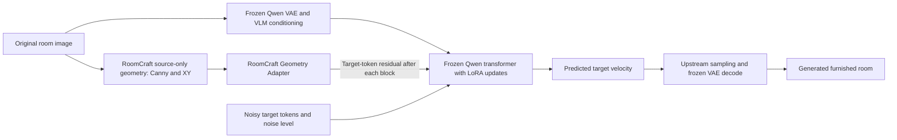

# Mathematics & Neural Network Engineering

RoomCraft adapts a pretrained image-editing model; it does **not** train a new foundation model. This document derives the equations actually implemented in the pinned source, distinguishes standard methods from project engineering, and separates successful optimization from image-quality evidence.

**Verified counts:** 23,543,808 trainable LoRA parameters in 958 tensors; 728,512 trainable RGA parameters in 18 tensors. LoRA and RGA train in **separate phases**, not jointly in the recorded pilots. Weights, optimizer states and complete datasets remain private. The public code/tests reproduce mathematical contracts; the full training runs cannot be independently replayed from this repository alone.

## 1. Architecture and what remains frozen

The pinned foundation is **Qwen-Image-Edit-2511**, revision `6f3ccc0b56e431dc6a0c2b2039706d7d26f22cb9`. Qwen supplies its pretrained VAE, visual-language encoder and dual-stream transformer; Diffusers supplies their implementation and sampling pipeline. RoomCraft supplies the paired-data/cache contracts, attention-adapter selection, target-only flow loss, training/checkpoint orchestration, geometry encoder/residual integration and evaluation tools.



During **LoRA training**, pretrained Qwen weights/biases are frozen and only the added A/B matrices are optimizer variables. Frozen VAE/VLM conditioning is cached under `torch.no_grad()`. During **RGA training**, both pretrained Qwen and the already trained V0.6 LoRA are frozen; only RGA learns. At inference, optional LoRA and RGA can both contribute without any optimization. The diagram depicts inference; training uses the velocity loss below instead of differentiating through an image-generation sampling loop.

Sources: [LoRA selection/objective](../src/roomcraft/qwen_objective.py), [cache](../src/roomcraft/qwen_cache.py), [LoRA trainer](../src/roomcraft/qwen_training.py), [RGA trainer](../src/roomcraft/rga_training.py), [inference](../src/roomcraft/editing.py). This document concerns the Qwen path; the preserved SDXL path uses its separate diffusion objective.

### Tensor contract

For batch one, one target frame and one clean reference frame:

| Tensor | Actual shape / meaning |
|---|---|
| Target pixels | `[1,3,1,H,W]` after upstream preprocessing |
| Normalized target latent | `[1,16,1,H/8,W/8]` |
| Packed target | `[1,N_t,64]`, with $N_t=(H/16)(W/16)$ |
| Clean packed source | `[1,N_r,64]`; its resolution can differ from the target |
| Cached VLM features and Boolean mask | `[1,T,3584]` and `[1,T]` |
| Transformer image input / prediction | `[1,N_t+N_r,64]` |
| Internal image/text stream width | $D=24\cdot128=3072$ |
| Image-grid metadata | Two `[1,height/16,width/16]` entries |

Qwen has 60 transformer blocks. A $512\times384$ **width × height** target has 768 tokens; a $1024\times768$ target has 3072. A portrait image transposes the grid. The original 512-target full-model RGA check recorded `[1,4912,64]` predictions: 768 target plus 4144 reference tokens; 4144 is an observed case, not a universal reference count.

The cache calls pinned upstream `_encode_vae_image`: posterior **mode**, checkpoint-specific channelwise latent means/stds, then upstream 2×2 packing. It does not apply SDXL's latent scaling constant. Source VAE reference area is approximately $1024^2$ pixels; the VLM source representation uses approximately $384^2$. These are separate conditioning paths. Target dimensions follow `edit_size`, with no crop or hidden random augmentation. [Encoding/shape tests](../tests/test_qwen_cache_eval.py) exercise the upstream resize/pack entry point.

## 2. LoRA forward pass, dimensions and parameter savings

In [`LoRALinear`](../src/roomcraft/lora.py), use row-vector batches $X\in\mathbb{R}^{n\times d_{\mathrm{in}}}$, frozen weight $W_0\in\mathbb{R}^{d_{\mathrm{out}}\times d_{\mathrm{in}}}$, and frozen bias $b_0$:

$$
A\in\mathbb{R}^{r\times d_{\mathrm{in}}},\qquad
B\in\mathbb{R}^{d_{\mathrm{out}}\times r},\qquad s=\frac{\alpha}{r},
$$

$$
H=XW_0^\top+b_0+s(XA^\top)B^\top,\qquad
\Delta W=sBA,\qquad \operatorname{rank}(\Delta W)\le r.
$$

Only $r(d_{\mathrm{in}}+d_{\mathrm{out}})$ parameters are added, rather than training $d_{\mathrm{in}}d_{\mathrm{out}}$ dense weights. RoomCraft's selected projections are all $3072\times3072$. At $r=\alpha=8$, each A/B pair has $8(3072+3072)=49{,}152$ parameters, about 0.521% of that dense matrix's weights.

The selection covers `to_q`, `to_k`, `to_v`, `to_out.0`, `add_q_proj`, `add_k_proj`, `add_v_proj` and `to_add_out` in each block, **except the final block's `to_add_out`**. That final text output has no path to the image loss; a tiny real-Qwen implementation backward test verifies the reachability issue. Therefore:

$$
(60\cdot8-1)\cdot49{,}152
=479\cdot49{,}152
=23{,}543{,}808.
$$

There are 958 trainable A/B tensors. The meta-architecture has 20,430,401,088 frozen transformer parameters; LoRA is about 0.1151% of the transformer-plus-adapter count, excluding the separate VAE/VLM. This saves parameter/gradient/optimizer storage, **not** the cost of loading the foundation or backpropagating through its activations.

A uses Kaiming-uniform initialization and B starts at zero, making the initial update zero. A/B masters are FP32; BF16 autocast may execute matmuls at lower precision, and the delta is cast back to the base output dtype. There is no LoRA dropout in this implementation. The project `.a/.b` checkpoint format is not advertised as drop-in PEFT interchange. Low-rank adaptation itself is [Hu et al.'s LoRA](https://arxiv.org/abs/2106.09685); RoomCraft's contribution is its implementation, gradient-reachable projection selection and integration.

## 3. Conditional flow-matching path and derivation

For a reviewed empty/furnished pair $(x,y)$ and instruction $c$, frozen upstream encoders produce packed furnished-target latent $z_0$, clean source latent $z_x$, and VLM features $e(x,c)$. The following is the training path in [`flow_path` and `paired_loss`](../src/roomcraft/qwen_objective.py):

$$
\sigma\sim\mathcal{U}[0,1),\qquad
\epsilon\sim\mathcal{N}(0,I),\qquad
z_\sigma=(1-\sigma)z_0+\sigma\epsilon.
$$

Holding the sampled endpoints fixed gives the conditional target velocity:

$$
u_\sigma=\frac{\partial z_\sigma}{\partial\sigma}=\epsilon-z_0,
\qquad z_{\sigma=0}=z_0,\quad z_{\sigma=1}=\epsilon.
$$

The model input concatenates **noisy target first, clean source second**:

$$
p=f_{\Theta,\omega}\bigl([z_\sigma;z_x],\sigma,e(x,c),\mathrm{grids},\mathrm{mask}\bigr).
$$

Here $\Theta$ denotes frozen foundation parameters and $\omega$ the LoRA matrices. During RGA training the same prediction also depends on RGA parameters $\phi$, while $\Theta,\omega$ stay frozen. The semicolon denotes concatenation along tokens.

This is conditional velocity regression: for fixed conditioning, the minimum-MSE predictor is the conditional expectation of the sampled velocity given the noisy input and noise level. That is a mathematical interpretation of the objective, not a claim that the finite pilot learns the exact transport field.

The noise-to-data inference direction runs from high to low $\sigma$; it does not negate the training target. Qwen's `zero_cond_t=True` routes noisy target modulation at $\sigma$ and clean reference modulation at zero. The pinned implementation is checked by the [time/clean-reference backward test](../tests/test_qwen_training.py).

RoomCraft deliberately uses **uniform sigma, unit loss weighting, no classifier-free prompt dropout**, and the existing upstream inference scheduler. It does not claim to reproduce Qwen's pretraining distribution or to train on the inference scheduler's dynamically shifted timestep distribution. The straight interpolation is an established flow/rectified-flow construction, not an invented RoomCraft method; see [Flow Matching](https://arxiv.org/abs/2210.02747) and [Rectified Flow](https://arxiv.org/abs/2209.03003).

## 4. Loss definitions and exact reductions

For $C=64$, batch one and target error $E_{ic}=p_{ic}-u_{ic}$, [`target_flow_loss`](../src/roomcraft/qwen_objective.py) casts prediction/velocity to FP32, slices the first $N_t$ tokens, squares and takes a mean over **every target element**:

$$
\mathcal{L}_{\mathrm{flow}}
=\frac{1}{N_tC}\sum_{i=1}^{N_t}\sum_{c=1}^{C}E_{ic}^2,
\qquad
\frac{\partial\mathcal{L}_{\mathrm{flow}}}{\partial p_{ic}}
=\frac{2E_{ic}}{N_tC}.
$$

Reference **output** predictions receive zero direct reconstruction gradient. Reference representations still influence target predictions through attention. This is not a loss on decoded pixels, window coordinates, architectural semantics or camera calibration; it cannot guarantee unchanged source pixels.

### Implemented optional mask-weighted velocity term

[`architecture_weights`](../src/roomcraft/rga.py) average-pools the supplied protected mask into 16×16 token occupancies $w_i\in[0,1]$. [`masked_velocity_loss`](../src/roomcraft/rga.py) implements:

$$
\mathcal{L}_{\mathrm{mask}}
=\frac{\sum_{i,c}w_iE_{ic}^2}{C\sum_iw_i},
\qquad
\mathcal{L}=\mathcal{L}_{\mathrm{flow}}+\lambda_{\mathrm{arch}}\mathcal{L}_{\mathrm{mask}}.
$$

An active weighted term rejects empty/invalid occupancies, and training additionally requires verified visible-architecture masks. It is still **paired-target velocity error**, not an edge-image, depth-reconstruction or decoded geometry loss. **All recorded RGA pilots used $\lambda_{\mathrm{arch}}=0$**: no extra architectural-supervision result is claimed. [Analytic mask-gradient tests](../tests/test_rga.py) cover the implemented optional path.

## 5. Backpropagation and the chain rule

Autograd applies reverse-mode differentiation through the selected computation graph. Frozen parameters are not optimizer variables and have no stored `.grad`; this does **not** assert that their formal mathematical partial derivatives vanish.

For one LoRA layer, let $D_H=\partial\mathcal{L}/\partial H\in\mathbb{R}^{n\times d_{\mathrm{out}}}$ and $G_W=D_H^\top X$:

$$
\frac{\partial\mathcal{L}}{\partial B}=sG_WA^\top,\qquad
\frac{\partial\mathcal{L}}{\partial A}=sB^\top G_W,\qquad
\frac{\partial\mathcal{L}}{\partial X}=D_HW_0+sD_HBA.
$$

These are the chain rule for the two low-rank matrix multiplications, not a separate optimizer. At $B=0$, A's **data-loss gradient** is zero while B can learn. A may nevertheless change on the first AdamW step because the LoRA configuration uses nonzero decoupled weight decay. Zero data-loss gradient is not the same as no optimizer update.

For any sequence of differentiable layers, an upstream adjoint is multiplied by each downstream Jacobian transpose:

$$
\nabla_{\theta}\mathcal{L}
=J_{h,\theta}^{\top}\nabla_h\mathcal{L},
\qquad
\nabla_{h_\ell}\mathcal{L}
=J_{h_{\ell+1},h_\ell}^{\top}\nabla_{h_{\ell+1}}\mathcal{L}.
$$

The [endpoint/analytic-gradient test](../tests/test_qwen_training.py), LoRA backward test, accumulation test and RGA tests verify gradients/shapes against these contracts. Tests called “real Qwen” instantiate the actual Diffusers class at **tiny random dimensions**; those tests are not pretrained-model quality evidence.

## 6. RoomCraft Geometry Adapter forward pass

RGA is a RoomCraft-designed implementation of structural conditioning, **not the invention of geometry-conditioned generation** or a pretrained third-party ControlNet.

### Source-only cue tensor

[`geometry_input`](../src/roomcraft/rga.py) creates $G\in\mathbb{R}^{1\times7\times H\times W}$:

1. Canny edges: RGB resized without cropping, grayscale, thresholds 100/200 with `L2gradient=True`, scaled from 0/255 to 0/1.
2. Optional binary protected mask.
3. Mask-available flag.
4. Optional supplied relative depth, normalized by 2nd/98th percentiles with a $10^{-6}$ denominator floor and clipped to [0,1].
5. Depth-available flag.
6. Pixel-center horizontal coordinate $x_j=2(j+\tfrac12)/W-1$.
7. Pixel-center vertical coordinate $y_i=2(i+\tfrac12)/H-1$.

Executed sidecars use **Canny + XY only**; channels 2–5 above are zero. No depth network or semantic segmentation is inferred, and the furnished target supplies no cue input. Canny/NumPy preprocessing is fixed, outside autograd; the trainable encoder starts after this tensor is formed.

### Encoder, token order and count

Four Conv2d(kernel 4, stride 2, padding 1) → GroupNorm(8 groups) → SiLU stages feed a zero-initialized 1×1 projection. Biases and normalization affine parameters are included:

| Stage | Channels / output for $W=512,H=384$ | Trainable parameters |
|---|---|---:|
| Conv4 + GN + SiLU | 7 → 32; `[1,32,192,256]` | 3,680 |
| Conv4 + GN + SiLU | 32 → 64; `[1,64,96,128]` | 32,960 |
| Conv4 + GN + SiLU | 64 → 96; `[1,96,48,64]` | 98,592 |
| Conv4 + GN + SiLU | 96 → 128; `[1,128,24,32]` | 196,992 |
| Conv1 projection | 128 → 3072; `[1,3072,24,32]` | 396,288 |
| **Total** | 18 tensors | **728,512** |

A conv/GN stage contributes $16c_{\mathrm{in}}c_{\mathrm{out}}+c_{\mathrm{out}}+2c_{\mathrm{out}}$ parameters; SiLU contributes none. The projection contributes $128\cdot3072+3072$. Flattening row-major height/width yields $U_\phi(G)\in\mathbb{R}^{1\times N_t\times3072}$. Matching token spacing/order does not mean RGA and the VAE have identical receptive fields.

### Shared target-only block residual

For $L=60$ blocks, user strength $s_g$ and checkpoint gain $g$:

$$
R=\left[\frac{s_g\,g}{L}U_\phi(G);\,0_{1\times N_r\times D}\right],
\qquad
h_{\ell+1}=F_\ell(h_\ell,\text{text state},\sigma)+R.
$$

This is the real-arithmetic description of [`token_residual`](../src/roomcraft/rga.py). The implementation casts U to the input hidden dtype **before** multiplying by $s_g\,g/L$. Diffusers repeats a one-element `controlnet_block_samples` list after **every** transformer block; RoomCraft divides by L to normalize that repeated injection. It is one shared field, not 60 independently trained encoders. Reference-token residuals are directly zero, but joint attention can still change reference/text states indirectly.

The initial gain-one configuration defaults to $g=1$. The **trained calibrated V0.9 checkpoint** supplies $g=10^8$ and uses $s_g=1$; this documented unit calibration is exploratory, not a newly invented mathematical method or an optimized universal gain. A nonzero tiny BF16 residual can round away beside a much larger hidden state; trained/nonzero is not equivalent to numerically influential.

RGA inference supports one target/reference, batch one and exclusive residual control. Strength zero bypasses RGA. The same residual conditions separate conditional/negative-prompt CFG calls. The original transformer object/config/cache interface is retained; nested/concurrent RGA contexts are rejected and hooks are removed on exit. [Inference-context and BF16 tests](../tests/test_rga.py), [loader/diagnostics](../src/roomcraft/rga_inference.py).

## 7. Gradient flow through a frozen Qwen transformer

Write $U=\operatorname{flatten}(P E_\psi(G)+b)$ with encoder parameters $\psi$ and zero-initialized projection P,b. In ideal real arithmetic, let $P_t$ extract target rows and let $\delta_{\ell+1}$ be the downstream adjoint at the state after adding R. Since the same U is reused:

$$
\nabla_U\mathcal{L}
=\frac{s_g\,g}{L}\sum_{\ell=0}^{L-1}P_t\delta_{\ell+1},
\qquad
\nabla_\phi\mathcal{L}=J_{U,\phi}^{\top}\nabla_U\mathcal{L}.
$$

Each adjoint already includes its downstream frozen-transformer Jacobians and the coupling of later blocks. This is not a claim that every block contributes equally. Floating-point casts/additions and BF16 rounding matter; PyTorch differentiates the executed graph rather than implementing an exact real-number computation.

With P initially zero, $\nabla_\psi\mathcal{L}=0$ on the first backward pass, while projection gradients can be nonzero. Updating P opens the encoder gradient path on later steps. The [learning/gradient test](../tests/test_rga.py) checks that the first encoder gradient is zero, a later one is nonzero, and frozen transformer tensors remain unchanged.

`requires_grad_(False)` freezes parameter accumulation, and `eval()` sets module behavior; **neither removes input derivatives**. Wrapping the whole RGA-training transformer call in `torch.no_grad()` would sever the learning path. Cache encoding and validation may legitimately use no-grad. Gradient checkpointing recomputes activations to trade compute for memory; it is not checkpoint-file resumption.

The RGA trainer checks absent frozen parameter gradients and hashes all frozen Qwen **and loaded LoRA** state bytes before/after the full run. Both recorded 100-update pilots preserve that digest exactly. For the earlier LoRA pilot, freezing is enforced by parameter flags, optimizer selection and gradient checks; this document does not invent a separate full-foundation byte-hash audit for that phase.

## 8. AdamW, accumulation, clipping and resumption

Both trainers call PyTorch AdamW over **only the current phase's trainable parameters**. The installed pinned PyTorch 2.8 defaults are $\beta_1=0.9,\beta_2=0.999,\epsilon_{\mathrm{opt}}=10^{-8}$, `amsgrad=False`. Constant learning rate is $\eta=10^{-4}$; there is no LR scheduler, EMA, distributed optimizer or quantized training.

For K microbatches, each loss backpropagates as $\mathcal{L}_k/K$. The logged gradient norm is measured **before** clipping; global L2 clipping at 1 happens once, then one optimizer step:

$$
\bar g_t=\frac1K\sum_{k=1}^K\nabla_\theta\mathcal{L}_k,\qquad
g_t=\bar g_t\min\!\left(1,\frac{1}{\|\bar g_t\|_2+10^{-6}}\right).
$$

The $10^{-6}$ term is the stabilizer used by the pinned PyTorch clipping utility. With elementwise products/square roots, zero-initialized moments and step t starting at one:

$$
\begin{aligned}
m_t&=\beta_1m_{t-1}+(1-\beta_1)g_t,&
v_t&=\beta_2v_{t-1}+(1-\beta_2)g_t^2,\\
\widehat m_t&=\frac{m_t}{1-\beta_1^t},&
\widehat v_t&=\frac{v_t}{1-\beta_2^t},\\
\theta_t&=(1-\eta\lambda_{\mathrm{wd}})\theta_{t-1}
-\eta\frac{\widehat m_t}{\sqrt{\widehat v_t}+\epsilon_{\mathrm{opt}}}.
\end{aligned}
$$

Weight decay is decoupled from the loss gradient. LoRA uses $\lambda_{\mathrm{wd}}=0.01$; RGA uses 0. FP32 master parameters/moments accompany BF16 autocast; the GradScaler exists but is disabled. These are standard [AdamW](https://arxiv.org/abs/1711.05101) updates executed by [PyTorch 2.8](https://docs.pytorch.org/docs/2.8/generated/torch.optim.AdamW.html), not a RoomCraft optimizer.

### Seeds, checkpoints and scope of replay

[`sample_seed`](../src/roomcraft/qwen_training.py) derives each microbatch seed from base seed q, zero-based optimizer step t and microbatch k:

$$
q_{t,k}=\bigl(q+1{,}000{,}003(tK+k+1)\bigr)\bmod(2^{63}-1).
$$

This seeds row sampling **with replacement**, noise and sigma; there is no hidden shuffled-dataloader cursor to resume. Validation averages per-example velocity MSEs over validation rows with fixed seeds `q+10000+i`; test rows are excluded from optimization and validation loss.

[`save_checkpoint`/`resume_checkpoint`](../src/roomcraft/checkpoint.py) save trainable safetensors, bound configuration, optimizer moments/counters, scaler state and completed optimizer step. A `.partial` directory is renamed after writing; full atomic-directory guarantees are for the intended same-filesystem POSIX workflow. The foundation is reloaded separately. Loading optimizer state uses `torch.load(weights_only=True)`.

Every expected recorded field except `steps` must match on resume, including model/data/implementation hashes and environment. A continuation uses a new output directory; only the allowed total step count increases. RGA also restores its saved validation-guard streak. Ordinary RNG snapshots are not stored: subsequent randomness is reconstructed from deterministic step/microbatch seeds. Inference can load compatible old checkpoints while exact **training resumption** can require their archived implementation hashes.

The two-update LoRA smoke verified save/reload/resume; the full LoRA run emitted a CUDA backward nondeterminism warning, so **bitwise full-model LoRA GPU replay is not claimed**. Tiny CPU tests verify exact resumed continuation. RGA uses strict deterministic algorithms (`warn_only=False`); initial and calibrated full-model smoke comparisons recorded exact adapter **and AdamW-state** equality at update two. That is evidence for those fixed runs, not a cross-GPU/kernel guarantee.

## 9. Actual configurations and engineering evidence

The pilots used 100 aligned synthetic pairs, split 70 train / 15 validation / 15 test by scene family; target size was $512\times384$. Twenty correlated room families and shared assets/templates limit independence. No real evaluation photograph was a training target. [Dataset provenance](DATASET_GENERATION.md), [LoRA model card](MODEL_CARD_V06_PILOT.md).

| Run | Optimizer updates / accumulation | Trainable parameters | Rank / strength / gain | Weight decay |
|---|---|---:|---|---:|
| V0.6 LoRA smoke | 2 / 1 | 23,543,808 | rank 8, alpha 8 | 0.01 |
| V0.6 fresh LoRA pilot | 100 / 4 | 23,543,808 | rank 8, alpha 8 | 0.01 |
| Original RGA smoke / pilot | 2 / 1; 100 / 4 | 728,512 | strength 1, gain 1 | 0 |
| Calibrated V0.9 smoke / pilot | 2 / 1; 100 / 4 | 728,512 | strength 1, gain $10^8$ | 0 |

All use seed 42, learning rate $10^{-4}$, clip norm 1, BF16 base/autocast, FP32 adapters and gradient checkpointing. Pilots are **100 updates / 400 microbatches**, fresh after the smoke, not 102 updates or 100 epochs. Pilot checkpoint/validation interval is ten updates; smoke interval is one. RGA architecture-loss weight is zero. The calibrated pilot's validation ceiling is 0.09694809885695577 with patience two; it completed all 100 updates without the guard stopping it.

Configs: [LoRA smoke](../configs/qwen_train_v06_smoke.json), [LoRA pilot](../configs/qwen_train_v06_pilot.json), [original RGA smoke](../configs/rga_v08_smoke.json), [original RGA pilot](../configs/rga_v08_pilot.json), [calibrated smoke](../configs/rga_v09_calibrated_smoke.json), [calibrated pilot](../configs/rga_v09_calibrated_pilot.json).

| Verified experimental fact | What it establishes / does not establish |
|---|---|
| LoRA pilot completed 100 updates; fixed validation MSE 0.0829930 at step 10 → 0.0775585 at step 100 | Real optimizer progress; validation MSE is not a realism/preservation score |
| Original gain-one RGA completed 100 updates; final validation 0.0775584791; initial enabled and disabled images were pixel-identical in six cases | A genuinely trained but numerically ineffective conditioning path can exist |
| Calibrated RGA completed a separate 100 updates; final validation 0.0798644789 | Active trained conditioning, not lower validation loss; this loss is about 2.97% higher than gain-one |
| Calibrated pre-clip gradient norms 0.12146–5.72680; final encoder gradient norm 0.07315 | Gradients reached RGA; not a geometry-quality metric |
| RGA full-run frozen Qwen/LoRA byte digest unchanged; zero-initial prediction maximum difference 0 | Frozen-state preservation and initial baseline equivalence |
| Both RGA two-update full-model replay checks match adapter/AdamW state exactly | Reproducible checkpoint resumption in the tested setup |

Training facts were cross-checked against the locally retained V0.6/V0.9 reports and machine-readable summaries. Public summaries are in the [LoRA card](MODEL_CARD_V06_PILOT.md), [research record](RESEARCH_RESULTS.md) and [current model card](MODEL_CARD.md). Full run logs, checkpoints and account-bound receipts are deliberately not bundled; these numerical summaries are not a promise that readers can reconstruct private artifacts from hashes alone.

### Controlled ablations and quality evidence

[`causality.py`](../src/roomcraft/causality.py) implements correct, disabled, zero-edge, shifted-edge, unrelated-edge, local edge-removal and count-matched random-removal controls. Disabled means **LoRA-only**, not unchanged Qwen.

- The recorded 36-image intervention study plus three synthetic subtraction ablations did **not** demonstrate dependable architectural control. A 64-pixel rightward cue shift yielded window-translation proxies of 0, 0 and −1 pixels in three synthetic rooms, not corresponding shifts.
- Zeroing edges changed encoder features by only about 0.59–1.78% relative L2 in the recorded CPU probe. The inference-only subtraction $U(E,XY)-U(0,XY)$ reduced residual RMS from roughly 23,000 to 78–172 and approached LoRA-only appearance in three synthetic cases; it is **not** a trained fix. Candidate real-photo/shifted subtraction runs were not executed.
- The later **Underwater** matched pair is one positive real-photo, single-seed result: wallpaper and room framing improve and an invented ceiling disappears. Actual first/last-block addition-delta RMS is about 23,126 / 23,118. This proves numerical activity and supports that example's visual finding; it does not overturn earlier mixed multi-room evidence or prove useful semantic cue control generally.

See [ablation summary](RESEARCH_RESULTS.md), [actual Underwater settings/activation and limitations](RGA_VALIDATION.md), [approved full-resolution comparison](assets/rga-underwater/comparison.png) and [sanitized acceptance evidence](security/rga_acceptance.json). Monitor counts, material/color changes, small geometric shifts, occlusion and physical furniture clearance remain limitations. Loss reduction, learned weights, nonzero gradients, residual arithmetic and image-quality improvement are **different claims**.

## 10. Reproduction, source map and tests

After installing the pinned Qwen environment, these existing tests run on CPU with tiny/random tensors; they do not train the private adapters, download foundation weights or provision compute:

```bash
uv sync --project environments/qwen --frozen
uv run --project environments/qwen python -m pytest \
  tests/test_qwen_training.py tests/test_qwen_cache_eval.py \
  tests/test_rga.py tests/test_causality.py tests/test_rga_release.py -q
```

| Claim | Source | Existing tests |
|---|---|---|
| Forward LoRA, reachable projections, frozen gradients | [lora.py](../src/roomcraft/lora.py), [qwen_objective.py](../src/roomcraft/qwen_objective.py) | `test_real_qwen_lora_backward_checkpointing_and_clean_condition` in [Qwen tests](../tests/test_qwen_training.py) |
| Flow endpoints, analytic MSE gradient, reference exclusion | [qwen_objective.py](../src/roomcraft/qwen_objective.py) | `test_flow_endpoints_analytic_gradient_and_reference_exclusion` in [Qwen tests](../tests/test_qwen_training.py) |
| Cache shapes and real upstream preprocessing entry point | [qwen_cache.py](../src/roomcraft/qwen_cache.py) | `test_encode_pair_uses_real_upstream_resize_pack_and_template_entrypoint` in [cache tests](../tests/test_qwen_cache_eval.py) |
| Accumulation and checkpoint continuation | [checkpoint.py](../src/roomcraft/checkpoint.py), [qwen_training.py](../src/roomcraft/qwen_training.py) | `test_accumulation_equals_mean_gradient_and_resume` and `test_rga_accumulation_and_exact_optimizer_resume` |
| Target/reference alignment and optional mask gradient | [rga.py](../src/roomcraft/rga.py) | [RGA tests](../tests/test_rga.py): `test_masked_velocity_analytic_gradient_and_empty_mask_rejection`; [causality tests](../tests/test_causality.py): `test_target_grid_alignment_excludes_reference_tokens` |
| Zero baseline, later encoder gradients, frozen tensor bytes | [rga.py](../src/roomcraft/rga.py), [rga_training.py](../src/roomcraft/rga_training.py) | `test_zero_initialization_preserves_real_qwen_and_existing_lora`, `test_real_qwen_learning_gradients_condition_effect_and_checkpointing`, `test_frozen_tensor_digest_detects_bf16_weight_mutation` in [RGA tests](../tests/test_rga.py) |
| Inference hooks, BF16 diagnostics and gain scaling | [rga_inference.py](../src/roomcraft/rga_inference.py) | `test_inference_context_matches_training_path_cfg_calls_disable_and_cleanup`, `test_residual_diagnostics_observe_without_changing_predictions`, `test_calibrated_gain_preserves_zero_baseline_and_scales_projection_gradient` in [RGA tests](../tests/test_rga.py) |
| Matched genuine off/on artifact identity | [app_service.py](../src/roomcraft/app_service.py) | [release acceptance tests](../tests/test_rga_release.py) |

Parameter counts can be independently checked **without pretrained weights or a GPU**:

```python
import torch
from diffusers import QwenImageTransformer2DModel
from roomcraft.qwen_objective import inject_qwen_lora
from roomcraft.rga import GeometryEncoder, RGAConfig

with torch.device("meta"):  # shapes only: no 20B-parameter allocation
    model = QwenImageTransformer2DModel(
        patch_size=2, in_channels=64, out_channels=16, num_layers=60,
        attention_head_dim=128, num_attention_heads=24,
        joint_attention_dim=3584, axes_dims_rope=(16, 56, 56),
        zero_cond_t=True,
    )
    targets = inject_qwen_lora(model, rank=8, alpha=8)
    assert len(targets) == 479
    assert sum(p.numel() for p in model.parameters() if p.requires_grad) == 23_543_808

rga = GeometryEncoder(RGAConfig())
assert sum(p.numel() for p in rga.parameters()) == 728_512
with torch.no_grad():
    assert rga(torch.zeros(1, 7, 384, 512)).shape == (1, 768, 3072)
```

This recount reproduces architecture/shape facts, not pretrained outputs. Full training additionally requires rights-reviewed aligned data, immutable caches, the pinned foundation, suitable hardware and separately obtained compatible private LoRA weights for RGA. No such training is performed by this documentation update. [Distribution limits](ADAPTER_DISTRIBUTION.md), [security/runtime caveats](SECURITY_AUDIT.md).

The existing `v1.1.0` release manifest/assets describe that **immutable tag**, not subsequent documentation-only commits on main. This update does not move the release tag, change a checkpoint or regenerate a release.

## Attribution and scope of originality

- **Qwen team:** [Qwen-Image-Edit-2511 model and pinned card](https://huggingface.co/Qwen/Qwen-Image-Edit-2511/blob/6f3ccc0b56e431dc6a0c2b2039706d7d26f22cb9/README.md); pretrained transformer, VAE and VLM. [Model/license boundaries](MODEL_CARD.md), [notices](../NOTICE.md).
- **Hu et al.:** [LoRA](https://arxiv.org/abs/2106.09685). Low-rank adaptation and its parameter-efficiency principle are upstream research.
- **Lipman et al.; Liu, Gong and Liu:** [Flow Matching](https://arxiv.org/abs/2210.02747), [Rectified Flow](https://arxiv.org/abs/2209.03003). Straight conditional paths and velocity regression are established mathematics; no optimal-transport/reflow procedure is newly implemented or claimed here.
- **Loshchilov and Hutter; PyTorch:** [AdamW](https://arxiv.org/abs/1711.05101), [versioned optimizer documentation](https://docs.pytorch.org/docs/2.8/generated/torch.optim.AdamW.html), [autograd](https://docs.pytorch.org/docs/2.8/notes/autograd.html). PyTorch implements differentiation, tensor kernels and optimizer updates.
- **Hugging Face Diffusers:** [pinned transformer](https://github.com/huggingface/diffusers/blob/v0.37.1/src/diffusers/models/transformers/transformer_qwenimage.py), [Edit Plus preprocessing/sampling](https://github.com/huggingface/diffusers/blob/v0.37.1/src/diffusers/pipelines/qwenimage/pipeline_qwenimage_edit_plus.py); Transformers supplies the VLM implementation. NumPy, OpenCV and safetensors support preprocessing/storage.
- **Zhang, Rao and Agrawala:** [ControlNet](https://arxiv.org/abs/2302.05543), an important precedent for conditioning frozen generators with zero-initialized residual paths. RGA is RoomCraft's compact source-cue encoder, target-lattice alignment, shared normalized Qwen residual path, calibration and audited integration—not the invention of geometry conditioning or zero initialization.

RoomCraft's contribution is the concrete, tested engineering and experimental record described above. Original source code does not imply invention of the chain rule, backpropagation, LoRA, flow matching, AdamW or the pretrained Qwen architecture. Architectural preservation remains an empirical question with explicitly limited evidence.
