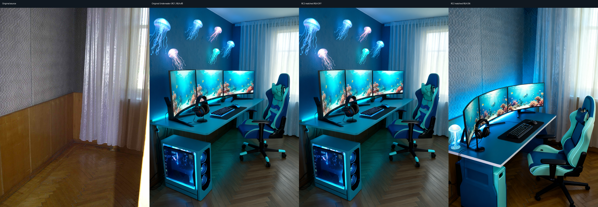

# RoomCraft RGA — verified Underwater comparison

The calibrated V0.9 RoomCraft Geometry Adapter is the default geometry-preservation option **when RoomCraft LoRA is selected**. The visible **Preserve Room Geometry — RoomCraft RGA** checkbox provides an OFF baseline. Unchanged Qwen remains the initial model choice and uses neither adapter. Reset restores unchanged Qwen; selecting RoomCraft LoRA enables RGA again. CLI `edit` retains explicit adapter arguments for reproducible research.

## Result and its limits

The matched Underwater Realm example shows a meaningful preservation improvement: RGA retains the distinctive loop-pattern wallpaper, brings the wall/corner/curtain composition closer to the original, and removes the ceiling plane invented by LoRA-only inference. Blue/turquoise furniture and aquatic imagery maintain the theme.

This is **one positive real-photo, single-seed example**, not proof of consistent improvement across rooms. Earlier multi-room and geometry-intervention studies did not demonstrate dependable spatial control. Colors, curtain folds, parquet details and small geometric shifts remain. The bright source foreground at the right edge is missing. Furniture hides several wall/floor boundaries; exact window extents behind curtains are unobservable. Monitor-count accuracy, support contacts, chair clearance and measured furniture fit remain limitations. Both images visibly contain three monitors in this example; that does not guarantee correct counts on other requests. Work, Relaxation and Mixed-purpose controls have CPU/browser/transport coverage, without fresh mode-specific GPU quality evidence.

[Open the full-resolution comparison gallery](assets/rga-underwater/index.html).

Photo: **upyernoz**, [Our Hotel Suite-1](https://commons.wikimedia.org/wiki/File:Our_Hotel_Suite-1_(4983234010).jpg), [CC BY 2.0](https://creativecommons.org/licenses/by/2.0/). Resized and AI edited; no compositing, no endorsement. [Attribution and modification notice](assets/rga-underwater/LICENSE.md).

## Controlled settings

| Setting | Matched value |
|---|---|
| Source/output | 768 × 1024; same source PNG hash |
| Foundation | Qwen/Qwen-Image-Edit-2511, revision `6f3ccc0b56e431dc6a0c2b2039706d7d26f22cb9` |
| LoRA | V0.6 step 100, SHA256 `1be7a8089b2fe037e7458a1b20bff5b76fe133dafe6aa4d3a3691a9772a442e6` |
| Sampling | Exact same Underwater prompt, seed 42, 40 steps, true CFG 4, one-space negative prompt |
| Runtime | BF16, same pinned scheduler/config, no quantization, no offload, raw output |
| RGA on | Calibrated V0.9 step 100, strength 1, checkpoint gain 1e8 |
| RGA SHA256 | `31625ddd4f82f10c8ff08947ffe68aa8d08682813c2b47e11cab15321ae56fca` |

The historical RC1 reference and fresh RC2 RGA-off PNG are byte-identical (`12b56067938cfcc358c83920bee755ad1c512f04cac4b7f9d0fa7ade2ee9a86f`). RGA-on is `619a2145d8ca8b541031f617aabb36576c327887e9cc2e92b650ba648545c77a`. Application/composer version and runtime timing differ between historical and fresh runs; prompt and model/sampling identities match. Off/on ran on two separately approved H100 workers with the same pinned image and dedicated RoomCraft storage. The release integration changes the UI default and label; it changes no inference mathematics or trained tensors.

## Loading and actual conditioning

Remote weight/config hashes matched before inference. The loader requires the pinned base and frozen-LoRA identity, exact tensor keys, finite values and strict state loading. The actual RGA-on first conditional forward recorded:

| Block | Residual RMS | Actual addition-delta RMS | Elements unchanged after addition |
|---|---:|---:|---:|
| First | 23,119.293 | 23,126.148 | 3.709% |
| Last | 23,119.293 | 23,117.809 | 12.073% |

These measurements prove active conditioning on this photo. Output differences alone do not establish quality. [Sanitized acceptance evidence](security/rga_acceptance.json), [RGA-on metadata](assets/rga-underwater/rga-on.json), [RGA-off metadata](assets/rga-underwater/rga-off.json).

An initial browser race downloaded a stale off result under an on label; metadata validation rejected it. The approved retry completed a genuine on job, recovered directly from the application-validated local job when a browser wait failed to recognize Gradio's button. The final wait checks fresh gallery job URLs. Invalid downloads were excluded from this public gallery. No GPU was provisioned for the final release audit. Private raw receipts and original candidates remain preserved outside the source ZIP.

Weights remain separately distributed private artifacts; the source candidate includes neither adapter. See [distribution requirements](ADAPTER_DISTRIBUTION.md) and [security limitations](SECURITY_AUDIT.md).
